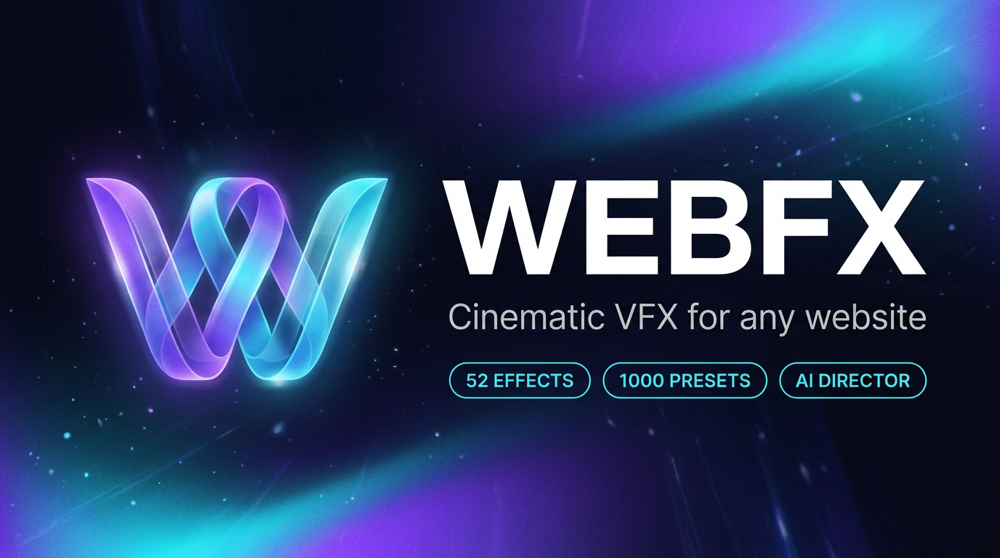

# WebFX



Cinematic VFX for any website. A Chrome extension (Manifest V3) that layers
movie-style visual effects over any page you browse — explosions on click,
matrix rain, film grading, a Thanos snap, and much more.

**52 handcrafted effects + 1000 lab presets + an infinite generator.
Zero dependencies. Zero build step. Only selected effects are loaded.**

Built-in **Auto-Guard** keeps your browser safe: at most 4 effects (and one
cinematic filter) run at once - enable more and the oldest auto-swaps out.
Try the **dice button** for a random curated scene, or the **AI Director**
to auto-rotate 19 hand-picked scenes every 30 seconds.

## Install (Load unpacked)

1. Clone or download this repository.
2. Open `chrome://extensions` in Chrome (or any Chromium browser).
3. Enable **Developer mode** (top right).
4. Click **Load unpacked** and select the repository folder.
5. On any page, click the WebFX toolbar icon (or press **Alt+W**) to open
   the sidebar on the right quarter of the screen. Toggle effects from
   the icon-tab category rail. Press **Esc** or the X to close it.

## Effects (52)

**Click & Keys (11):** Explosion Click, Water Ripple, Confetti Burst, Screen
Shake, Thanos Snap, Comic POW!, Combo Counter, Keystroke Sparks, Screen
Crack, Impact Flash, Bouncy Balls.

**Cursor Trails (9):** Fire Trail, Sparkle Trail, Neon Ribbon, Black Hole,
Pixel Snake, Orbit Planets, Torchlight, Hearts Trail, Kaleidoscope.

**Ambient & World (20):** Matrix Rain, Snowfall, Rainstorm, Fireflies, Rising
Embers, Bubbles, Starfield Warp, Lightning Storm, Fireworks, Aurora, Haunted
Fog, Underwater, Sakura Petals, Autumn Leaves, Meteor Shower, Balloons,
Paper Planes, Friendly Ghosts, Disco Fever, Synthwave Horizon.

**Cinematic Filters (12, exclusive - one at a time):** Cinematic Grade, Cyber
Glitch, VHS Retro, CRT Monitor, Night Vision, Thermal Camera, Blueprint,
Film Noir, Old Film 1920s, Comic Book, Hologram, Dreamy Bloom.

Mix and match freely within the guard budget. A global **Intensity** slider
(0.2x-2x) scales particle counts and strengths. Settings sync across your
Chrome profiles.

## Effect Lab (flask tab)

- **Generate Random Effect**: one click creates a brand-new effect from a
  parametric space of 10 shapes x 12 palettes x 8 physics x 6 emitters
  (5,760 base combinations, with continuous speed/size/glow/spin variation
  on top - effectively infinite). Every result gets a procedural name like
  "Quantum Aurora Vortex".
- **Preset Library**: 1000 curated, searchable presets (seeds 1-1000),
  rendered in chunks so the sidebar stays instant.
- **Favorites**: hit the heart to save up to 30 generated effects. Only the
  seed is synced - the exact same effect is regenerated deterministically
  on every tab and profile.
- Lab effects run through ONE shared parametric engine module
  (`effects/generated.js`), so a thousand presets still cost one lazy import.

## Performance safety (Auto-Guard)

- **Hard limits**: max 4 active effects, total render cost <= 7, and only
  ONE fullscreen cinematic filter. Enabling beyond the limit automatically
  swaps out the oldest effect - nothing ever piles up.
- **Lazy loading**: effect modules are `import()`-ed only when enabled.
- **One canvas, one RAF loop** shared by every canvas effect.
- **Hidden-tab pause**: the render loop fully stops when the tab is not visible.
- **Adaptive resolution**: sustained low FPS drops the canvas to 1x DPR.
- **Clean teardown**: disabling removes every listener, timer and overlay.

## Shuffle & AI Director

- **Dice button**: instantly applies a random curated scene (never the same
  one twice in a row). 19 scenes: Blockbuster, Cyberpunk, Haunted Night,
  Deep Space, Anime Fight, Retrowave, Fairy Tale, Hacker Den, Arcade,
  Thunderstorm, Daydream, Wildcard Lab, and more.
- **AI Director** (sparkle button): auto-rotates scenes every 30 seconds via
  `chrome.alarms`. The toolbar badge shows `AI` while it runs. Any manual
  toggle hands control back to you. Every scene respects the guard budget.

## Architecture

```
manifest.json
src/
  core/
    registry.js      Effect catalog (id, name, category, cost, module file)
    app.js           Lazy loader + lifecycle manager + budget enforcement
    budget.js        BudgetGuard: max active / cost / exclusive filters
    scenes.js        19 curated scene presets for shuffle + AI Director
    generator.js     Seeded parametric preset generator (Effect Lab)
    base-effect.js   Abstract BaseEffect: lifecycle + auto-cleanup
    canvas-layer.js  ONE shared canvas + ONE RAF loop for all effects
    particles.js     Particle / ParticleSystem classes
    pointer.js       Shared pointer tracker (single global listener set)
    utils.js         Tiny math helpers
    sidebar-host.js  Injects the sidebar iframe (right 25vw, slide-in)
  content/loader.js  Bootstrap, imports app + sidebar host on demand
  background/service-worker.js  Toolbar/Alt+W toggle, on-demand injection, badge
  background/director.js        AI Director alarm-based scene rotation
  sidebar/           Elegant dark UI: icon-tab rail, search, shuffle, AI toggle
    lab.js           Effect Lab tab: generator, favorites, 1000-preset browser
  effects/           One ES module per effect, each a BaseEffect subclass
    generated.js     ONE parametric engine shared by every lab preset
```

Design rules:

- **Lazy loading** — effect modules are `import()`-ed only when enabled.
  Disabled effects are never fetched, parsed, or executed.
- **Atomic files** — every source file is under 300 lines of code.
- **OOP** — every effect is a class extending `BaseEffect`; shared services
  (`CanvasLayer`, `Pointer`, `ParticleSystem`) are classes owned by `App`.
- **Clean teardown** — disabling an effect removes every listener, timer,
  style, overlay and canvas drawer it created. Thanos Snap even restores
  every element it "snapped".
- **Lightweight** — all canvas effects share one canvas and one
  `requestAnimationFrame` loop; frame-rate-independent motion via delta time.

## Adding your own effect

1. Create `src/effects/my-effect.js`:

```js
import BaseEffect from '../core/base-effect.js';

export default class MyEffect extends BaseEffect {
  async onEnable() {
    this.onCleanup(this.pointer.onDown((x, y) => { /* ... */ }));
    this.draw((ctx, { w, h, dt, t }) => { /* per-frame drawing */ });
  }
}
```

2. Add one entry to `src/core/registry.js`. Done — the sidebar and lazy loader
   pick it up automatically.

## Brand & Promotion Kit

Ready-to-use marketing assets live in [`promo/`](promo/) - all free to reuse
under the same MIT license:

| Asset | File | Use |
| --- | --- | --- |
| Logo mark | `promo/logo.png` | App icon, avatars (1024x1024) |
| Logo lockup | `promo/logo-wordmark.png` | Docs, headers, slides |
| Software box | `promo/software-box.png` | 3D product shot |
| Poster | `promo/poster.png` | Print / key art (portrait) |
| Banner | `promo/banner.png` | Wide hero / README header |
| Social preview | `promo/social-preview.png` | GitHub/Open Graph (1280x640) |
| Feature showcase | `promo/feature-showcase.png` | Category overview grid |
| Social square | `promo/social-square.png` | Instagram / X posts (1:1) |
| Video ad | `promo/webfx-ad-15s.mp4` | 15s 1080p launch ad with sound |

Brand palette: violet `#8b5cf6`, cyan `#22d3ee`, deep navy `#0b0b14`.

## Notes

- Effects are cosmetic overlays; they never modify page content (except
  Thanos Snap hiding elements, fully reversible via its toggle).
- Some pages (e.g. the Chrome Web Store) block content scripts by design.
- Not affiliated with Marvel; "Thanos Snap" is a playful fan reference.

## License

[MIT](LICENSE) — use it, fork it, ship it.